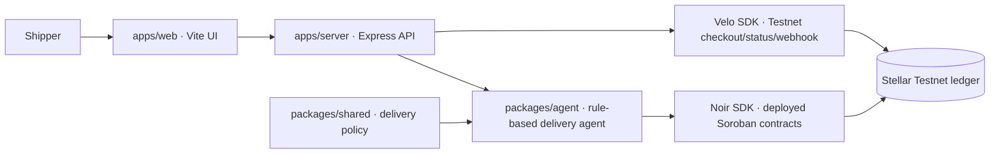

# AeroPay

One-line pitch: A delivery agent releases a cold-chain carrier payout through Noir only when delivery evidence and the owner's Testnet policy pass; Velo confirms the shipper's booking payment.

**Live website:** https://aeropay-agentic-payment.onrender.com

**Demo video (2 min):** [Add the two-minute end-to-end demo link before submission]

**Team:** [Byte Me Daddy] ([Discord handle])

## Problem

Cold-chain deliveries can arrive late, warm, or at the wrong destination. A supplier still needs a clear way to get paid, while the cargo owner needs a payment that stops when the delivery conditions fail.

## Solution

AeroPay pairs a Velo Testnet booking checkout with a rule-based delivery agent. The server treats Velo's ledger-confirmed booking as the paid order, then checks the delivery evidence and the owner's Noir policy before authorizing the carrier payout from escrow. The temperature and destination readings in this prototype are sample inputs, not authenticated sensor or GPS attestations.

## How the agentic payment works

1. The shipper creates and pays a Testnet booking checkout through Velo.
2. Velo confirms the PaymentIntent against Stellar ledger data and sends a signed webhook to AeroPay. The server verifies the signature and can also retrieve the PaymentIntent status from Velo.
3. At delivery, the app asks the server to run the agent with a sample temperature and checkpoint result. The browser never receives the Noir or Velo secrets.
4. The agent refuses immediately when the temperature is outside 2–8°C or the checkpoint is missing.
5. For a safe delivery, the server requires the Velo booking to be confirmed, loads the device policy with the Noir SDK, and calls `checkPayment`.
6. Only when the Noir policy allows the configured Testnet amount does the agent call `authorizePayment`. A failed check submits no payout; a successful authorization returns a Stellar Testnet transaction hash. The merchant claims the pending balance separately through Noir.

The over-cap scenario asks Noir to check one stroop above the active policy maximum, then displays the refusal. That scenario never calls `authorizePayment`.

## Architecture



## Noir integration

- Noir SDK: `@noirx402/agent-sdk` `0.3.0`.
- Contracts: the SDK's deployed Stellar Testnet `device_registry`, `agent_registry`, and `payment_escrow` contracts.
- `getPolicy`, `checkPayment`, and `authorizePayment` are called by the server-side agent in [`packages/agent/src/index.js`](packages/agent/src/index.js).
- The agent key, device hash, merchant address, asset contract, and payout amount stay in the server `.env`.

## Velo integration

- Velo SDK: `@carts1024/velo-sdk` `0.1.0-alpha.4` (server-side Testnet SDK).
- Velo creates a separate fixed-amount shipment booking checkout in the configured Testnet asset. This is not the PHP route estimate and is not a PHP conversion.
- AeroPay retrieves PaymentIntent status from Velo and verifies `payment.succeeded` webhooks using the raw request body and `x-velo-signature` header.
- Checkout, status, and webhook code is in [`apps/server/src/server.js`](apps/server/src/server.js). The browser only calls AeroPay's API; it never sees the Velo API key or webhook secret.

This is a single-process hackathon prototype. Checkout mappings, recent webhook IDs, and agent decisions are held in memory and reset when the server restarts. Delivery readings and the selected checkpoint are user-provided sample values; they are not signed sensor or GPS attestations.

## Testnet proof

No live transaction has been recorded in this repository yet. Add at least one Stellar Expert link to a demo transaction before submitting:

- Noir carrier payout: [Add Stellar Expert Testnet transaction link]
- Velo booking payment: [Add Stellar Expert Testnet transaction link]

## Repo structure

```text
apps/
  web/                  Vite frontend
  server/               Express API, Velo checkout/webhook, delivery endpoint
packages/
  agent/                rule-based agent and Noir SDK calls
  shared/               delivery policy shared by server and agent
docs/                   screenshots and demo materials
.env.example            empty environment-variable template
package.json            npm workspaces and root commands
README.md               judging and setup guide
```

## Run it locally

1. Install a supported Node.js version: `^22.23.4`, `^24.22.1`, or `>=26.12.1`.
2. Install the Noir Chrome extension and create/fund the required Stellar Testnet owner, agent, and merchant setup. Configure the deployed Noir policy and escrow.
3. From the repository root, run `npm install` to install workspace dependencies and create the npm lockfile.
4. Copy `.env.example` to `.env`; add the Velo Testnet API key and Noir Testnet values on the server. Never commit `.env`.
5. Run `npm run dev`. Open the Vite app at `http://localhost:5173`; the API runs at `http://localhost:4173`.
6. For production, set `APP_BASE_URL` to the deployed public HTTPS URL, configure Velo's webhook destination as `https://<your-host>/api/webhooks/velo`, build the web app with `npm run build`, and start the server with `npm run start --workspace @aeropay/server`.

Without credentials, the page displays setup status and the offline CLI remains available. It does not pretend a simulated result is a Testnet payment.

## Deploy on Render

This repository includes a Render Blueprint for a free Node web service. In Render, create a Blueprint from this repository and select the `aeropay-demo` branch. Render reads `render.yaml`, builds the Vite app, serves it from Express, and checks `/api/health`. Render supplies `RENDER_EXTERNAL_URL`, which the server uses for Velo's return links unless `APP_BASE_URL` is set explicitly.

After the first deploy, add the Velo and Noir values from your local `.env` to the service's Environment settings. Never commit those secrets. Configure the Velo webhook URL as `https://<your-render-host>/api/webhooks/velo`, then redeploy and complete a Testnet rehearsal. Free services can spin down after inactivity; open the site before presenting and allow the first request time to wake it.

## Environment variables

| Name | What it is | Where to get it |
| --- | --- | --- |
| `VELO_API_KEY` | Velo Testnet API key | Create a Testnet project in the Velo Build dashboard |
| `VELO_WEBHOOK_SECRET` | HMAC secret for Velo webhook verification | Velo project webhook settings |
| `VELO_CHECKOUT_ASSET` | Testnet checkout asset (default `USDC`) | Select an asset enabled for the Velo Testnet project |
| `VELO_CHECKOUT_AMOUNT` | Fixed booking checkout amount (default `1.00`) | Set a small Testnet-only demo amount |
| `APP_BASE_URL` | Public app URL used for Velo return links | Local default is `http://localhost:5173`; use HTTPS when deployed |
| `PORT` | Express server port | Hosting platform provides this in deployment |
| `DEVICE_HASH` | SHA-256 hash of the Noir device/card UID | Generate from the linked card UID; see Noir setup |
| `AGENT_SECRET` | Noir agent's Stellar Testnet secret key | Create/register the agent through Noir; keep server-side |
| `MERCHANT_ADDRESS` | Carrier's Stellar Testnet public address | Merchant's Testnet wallet |
| `ASSET_CONTRACT_ID` | Stellar Testnet asset contract used by Noir | The Testnet asset selected for the Noir policy |
| `PAYMENT_AMOUNT` | Noir payout amount in the configured asset | Set within the registered Noir policy cap |
| `PAYMENT_ASSET_LABEL` | Display label for the configured payout asset | For example, `XLM` or `USDC`; display only |

## Screenshots

Add current screenshots of the public app, the Velo checkout/status, and both Noir allow/refuse outcomes before submission.

## What's next

- Connect signed cold-chain and destination evidence instead of sample inputs.
- Run a complete Testnet rehearsal and add transaction links.
- Deploy the app and verify the public Velo webhook can reach it.
- Record the required two-minute demo and add the team handles.

## Credits

- [Noir](https://github.com/noirx402/noir) and `@noirx402/agent-sdk` for constrained Testnet agent payments.
- [Velo](https://www.velo-build.dev) and `@carts1024/velo-sdk` for Testnet checkout, status retrieval, and signed webhooks.
- [Leaflet](https://leafletjs.com/) and [OpenStreetMap](https://www.openstreetmap.org/copyright) for the route picker.
